# Отчет по лабораторной работе: Система управления складом

## 1. UML-диаграмма классов

```mermaid
classDiagram
    class Product {
        <<abstract>>
        #int id_
        #string name_
        #Price price_
        #Quantity quantity_
        #Weight weight_
        #string category_
        -Warehouse* warehouse_
        +getId() int
        +getName() string
        +getPrice() Price
        +getQuantity() Quantity
        +getWeight() Weight
        +getCategory() string
        +transferTo(Warehouse& other) void
        +changeQuantity(int delta) void
        +setPrice(Price price) void
        +clone()* unique_ptr~Product~
    }

    class Electronics {
        <<abstract>>
    }
    class Clothing {
        <<abstract>>
    }
    class Food {
        <<abstract>>
    }

    class Smartphone {
        +clone() unique_ptr~Product~
    }
    class Laptop {
        +clone() unique_ptr~Product~
    }
    class TShirt {
        +clone() unique_ptr~Product~
    }
    class Jacket {
        +clone() unique_ptr~Product~
    }
    class Milk {
        +clone() unique_ptr~Product~
    }
    class Bread {
        +clone() unique_ptr~Product~
    }

    Product <|-- Electronics
    Product <|-- Clothing
    Product <|-- Food
    Electronics <|-- Smartphone
    Electronics <|-- Laptop
    Clothing <|-- TShirt
    Clothing <|-- Jacket
    Food <|-- Milk
    Food <|-- Bread

    class Price {
        -int value_
        +getValue() int
    }
    class Quantity {
        -int value_
        +getValue() int
    }
    class Weight {
        -double value_
        +getValue() double
    }

    Product *-- Price
    Product *-- Quantity
    Product *-- Weight

    class ProductFactory {
        <<abstract>>
        +createProduct(name, price, quantity, weight) unique_ptr~Product~
        +createProduct(id, name, price, quantity, weight)* unique_ptr~Product~
    }

    class SmartphoneFactory {
        +createProduct(id, name, price, quantity, weight) unique_ptr~Product~
    }
    class LaptopFactory {
        +createProduct(id, name, price, quantity, weight) unique_ptr~Product~
    }
    class TShirtFactory {
        +createProduct(id, name, price, quantity, weight) unique_ptr~Product~
    }
    class JacketFactory {
        +createProduct(id, name, price, quantity, weight) unique_ptr~Product~
    }
    class MilkFactory {
        +createProduct(id, name, price, quantity, weight) unique_ptr~Product~
    }
    class BreadFactory {
        +createProduct(id, name, price, quantity, weight) unique_ptr~Product~
    }

    ProductFactory <|-- SmartphoneFactory
    ProductFactory <|-- LaptopFactory
    ProductFactory <|-- TShirtFactory
    ProductFactory <|-- JacketFactory
    ProductFactory <|-- MilkFactory
    ProductFactory <|-- BreadFactory

    class Warehouse {
        -vector~unique_ptr~Product~~ products_
        -size_t maxSize_
        +addProduct(unique_ptr~Product~ product) void
        +removeById(int id) bool
        +removeByIndex(size_t index) void
        +findById(int id) Product*
        +findByCategory(string category) vector
        +findByPrice(Price price) vector
        +begin() WarehouseIterator
        +end() WarehouseIterator
    }

    class BasicWarehouseIterator~Value~ {
        -StorageIterator current_
        +operator*() reference
        +operator->() pointer
        +operator++() BasicWarehouseIterator&
        +operator==(BasicWarehouseIterator) bool
        +operator!=(BasicWarehouseIterator) bool
    }

    Warehouse "1" *-- "0..*" Product
    Product --> Warehouse : warehouse_
    Warehouse ..> BasicWarehouseIterator : порождает
    BasicWarehouseIterator --> Product : разыменовывает
    ProductFactory ..> Product : создает
```



---

## 2. Паттерны проектирования

### Фабричный метод (Factory Method)

Паттерн применен для создания объектов иерархии товаров без привязки клиентского кода к конкретным классам наследникам.

- Базовый абстрактный класс `ProductFactory` декларирует чисто виртуальный метод `createProduct(int id, const std::string& name, int price, int quantity, double weight)`, возвращающий `std::unique_ptr<Product>`. Также реализована перегрузка без явного ID, генерирующая уникальный идентификатор автоматически.
- Конкретные фабрики (`SmartphoneFactory`, `LaptopFactory`, `TShirtFactory`, `JacketFactory`, `MilkFactory`, `BreadFactory`) переопределяют фабричный метод и инкапсулируют логику создания конкретных классов продуктов.
- В самих товарах реализован метод `clone()`, который дополняет фабрику полиморфным копированием существующих объектов с сохранением их фактического типа.

Применение паттерна изолирует класс склада `Warehouse` от деталей создания объектов: склад принимает владение через `std::unique_ptr<Product>`.

### Итератор (Iterator)

Паттерн применен для последовательного обхода товаров склада без раскрытия структуры внутреннего хранилища (`std::vector<std::unique_ptr<Product>>`).

- Реализован шаблонный класс `BasicWarehouseIterator<Value>`, параметризуемый типом значения (`Product` или `const Product`). Это позволяет избежать дублирования логики для изменяемого и константного итератора.
- Объявлены псевдонимы `WarehouseIterator` и `ConstWarehouseIterator`.
- Итератор предоставляет интерфейс `std::forward_iterator_tag`:
  - `operator*` возвращает ссылку на `Product` или `const Product`, скрывая работу с `std::unique_ptr`.
  - `operator->` возвращает сырой указатель на объект товара.
  - Поддерживаются префиксный и постфиксный инкременты (`operator++`), а также операторы сравнения (`==`, `!=`).
  - Реализован неявный конструктор преобразования из неконстантного итератора в константный.
- Класс `Warehouse` предоставляет методы `begin()`, `end()`, `cbegin()`, `cend()`. Благодаря этому склад поддерживает range-based for и стандартные алгоритмы из `<algorithm>` (`std::find_if`, `std::distance` и др.).

---

## 3. Правило пяти для класса Warehouse

Класс `Warehouse` управляет динамическими ресурсами (`std::vector<std::unique_ptr<Product>>`) и поддерживает двустороннюю связь с товарами через указатель `warehouse_`. Для корректного управления ресурсами реализованы все пять специальных функций-членов.

1. **Деструктор (`~Warehouse`)**
   Освобождает занимаемые ресурсы. Поскольку товары хранятся в векторе умных указателей `std::unique_ptr<Product>`, удаление объектов выполняется автоматически при вызове деструктора вектора.
2. **Конструктор копирования (`Warehouse(const Warehouse& other)`)**
   Выполняет глубокое копирование склада. Для каждого товара из `other.products_` вызывается метод `clone()`. Новый склад получает собственные независимые копии товаров, а в скопированных товарах указатель `warehouse_` связывается с новым экземпляром склада.
3. **Оператор присваивания копированием (`operator=(const Warehouse& other)`)**
   Реализован по идиоме copy-and-swap: создается временная копия через конструктор копирования, после чего ее поля обмениваются с полями текущего объекта. Это обеспечивает строгую гарантию безопасности исключений: в случае сбоя при копировании исходный объект не повреждается.
4. **Конструктор перемещения (`Warehouse(Warehouse&& other) noexcept`)**
   Перемещает вектор `products_` и максимальный размер `maxSize_` из источника. Исходный объект остается в корректном пустом состоянии (`isEmpty() == true`) и пригоден для повторного использования. После перемещения вызывается метод `bindProducts()`, который обновляет указатели `warehouse_` у всех перемещенных товаров на адрес нового владельца.
5. **Оператор присваивания перемещением (`operator=(Warehouse&& other) noexcept`)**
   Освобождает текущие товары, забирает ресурсы из `other` и перепривязывает указатели товаров на текущий склад через `bindProducts()`. Исходный склад очищается. Предусмотрена защита от самоприсваивания (`this != &other`).

---

## 4. Результаты выполнения демонстрационных сценариев

Программа `labashop` выполняет 5 демонстрационных сценариев. Вывод программы:

```text
1. Создание склада, фабрики и итерация
Товаров: 6/10
1 | Смартфон | electronics | 60000 руб. | 12 шт. | 0.19 кг
2 | Ноутбук | electronics | 95000 руб. | 5 шт. | 1.6 кг
3 | Футболка | clothing | 1500 руб. | 30 шт. | 0.2 кг
4 | Куртка | clothing | 8000 руб. | 8 шт. | 0.9 кг
5 | Молоко | food | 100 руб. | 40 шт. | 1 кг
6 | Хлеб | food | 100 руб. | 25 шт. | 0.5 кг

2. Глубокое копирование
Оригинал: 1 | Смартфон | electronics | 60000 руб. | 12 шт. | 0.19 кг
Копия:    1 | Смартфон | electronics | 55000 руб. | 10 шт. | 0.19 кг
После присваивания копированием: 6 товаров

3. Перемещение склада
Исходный склад пуст: true
Адрес товара сохранён: true
После присваивания перемещением: 6 товаров
Адрес товара сохранён: true

4. Поиск и удаление
Товар с ID 3:
3 | Футболка | clothing | 1500 руб. | 30 шт. | 0.2 кг
Категория food:
5 | Молоко | food | 100 руб. | 40 шт. | 1 кг
6 | Хлеб | food | 100 руб. | 25 шт. | 0.5 кг
Цена 100 руб.:
5 | Молоко | food | 100 руб. | 40 шт. | 1 кг
6 | Хлеб | food | 100 руб. | 25 шт. | 0.5 кг
После удаления по ID и индексу:
Товаров: 4/10
2 | Ноутбук | electronics | 95000 руб. | 5 шт. | 1.6 кг
4 | Куртка | clothing | 8000 руб. | 8 шт. | 0.9 кг
5 | Молоко | food | 100 руб. | 40 шт. | 1 кг
6 | Хлеб | food | 100 руб. | 25 шт. | 0.5 кг

5. Перенос товара, изменение остатка и цены
На исходном складе: 5 товаров
На новом складе:
Товаров: 1/3
1 | Смартфон | electronics | 58000 руб. | 15 шт. | 0.19 кг
Адрес товара сохранён: true
```

### Краткое описание результатов

- **Сценарий 1**: Склад инициализирован с лимитом 10 позиций. Добавлены 6 различных продуктов с помощью конкретных фабрик. Вывод содержимого выполнен через обход склада циклом range-based for с использованием итератора.
- **Сценарий 2**: Выполнено глубокое копирование склада. Изменение цены (до 55000 руб.) и остатка (до 10 шт.) у товара в копии не затронуло оригинальный склад (в оригинале остались 60000 руб. и 12 шт.). Продемонстрирована независимость копий и работа копирующего присваивания.
- **Сценарий 3**: Проверены перемещающий конструктор и перемещающее присваивание. Исходный склад переходит в пустое состояние (`isEmpty() == true`), адреса объектов в памяти сохраняются без лишних переаллокаций.
- **Сценарий 4**: Продемонстрирована работа методов поиска (`findById`, `findByCategory`, `findByPrice`) и удаления (`removeById` по ID 3 и `removeByIndex` по индексу 0). После удаления склад сохранил оставшиеся 4 товара.
- **Сценарий 5**: Проверен метод `product->transferTo(destination)`. Товар перенесен с исходного склада на новый без пересоздания объекта (адрес сохранен). При этом товар успешно обновил атрибуты (цена 58000 руб., остаток 15 шт.) уже на новом складе.
